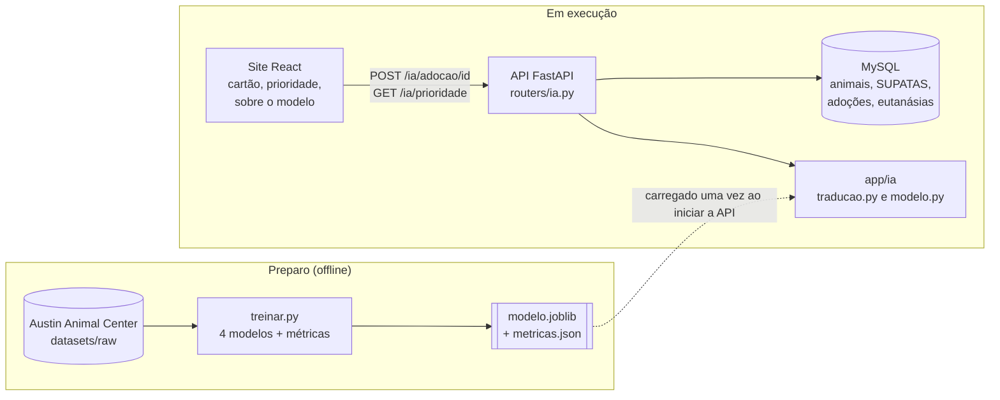
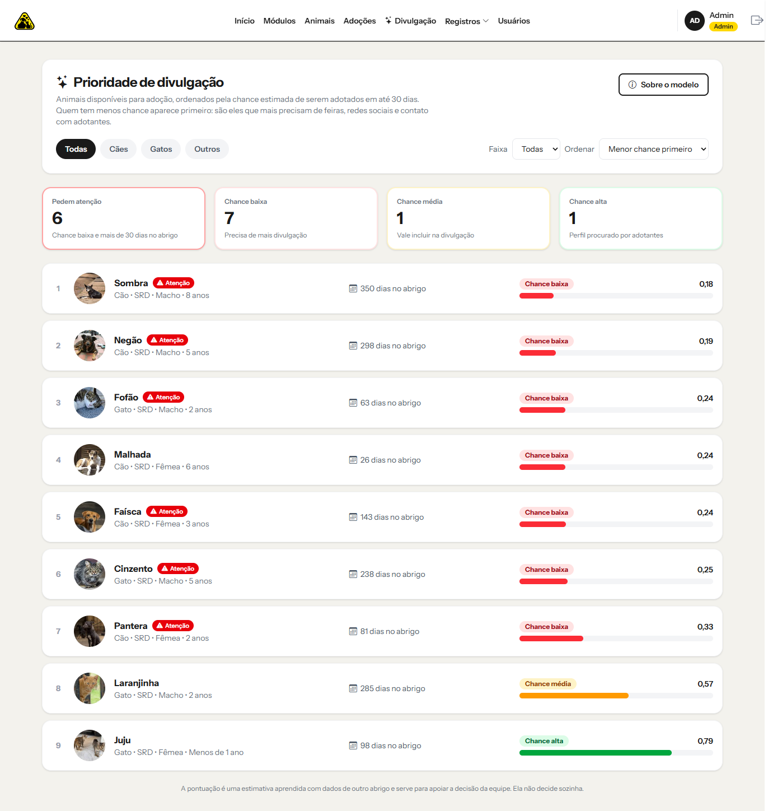
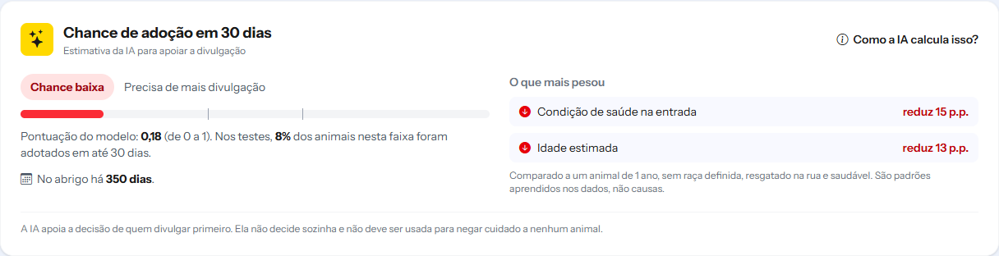
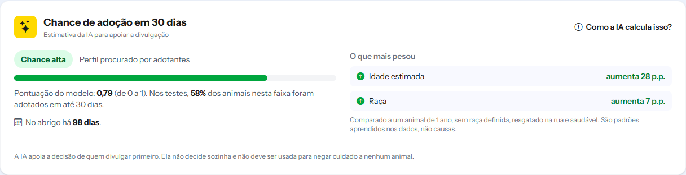
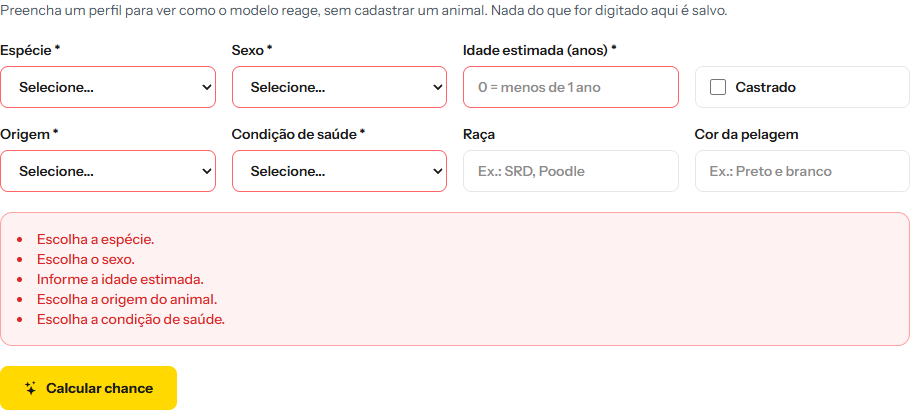
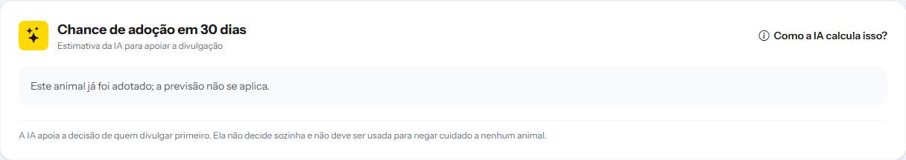
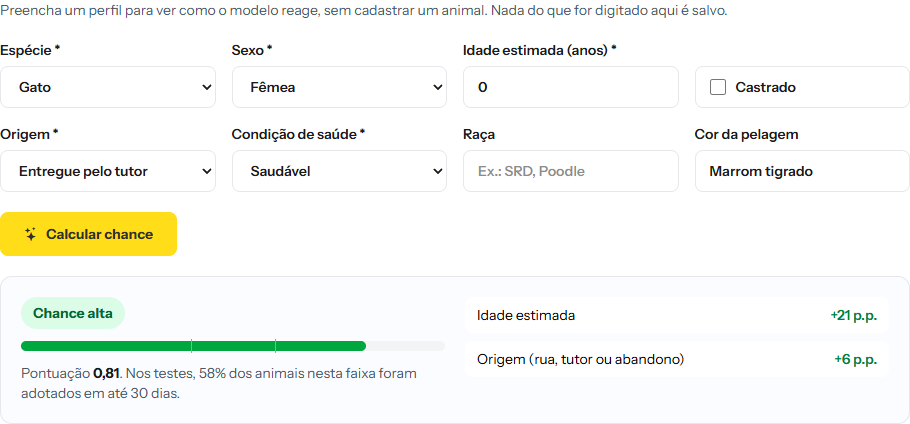
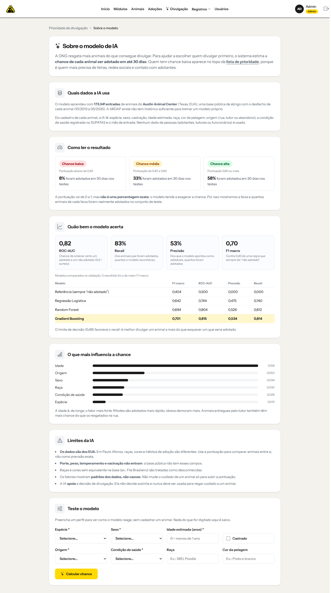

<div align="center">


# ARDAP

**Sistema de gestão da Associação Recanto dos Animais em Perigo**

Digitaliza os formulários em papel da ONG, reúne o histórico de cada animal<br>
e gera a prestação de contas para a prefeitura.


[Sobre](#sobre) •
[Funcionalidades](#funcionalidades) •
[Inteligência Artificial](#inteligência-artificial) •
[Arquitetura](#arquitetura) •
[Como rodar](#como-rodar) •
[Produção](#produção) •
[Equipe](#equipe)

</div>

---

## Sobre

A **ARDAP** resgata, trata e encaminha animais para adoção em Paulo Afonso/BA. Os
registros ficavam em formulários de papel, sem histórico por animal, sem controle de
acesso e com o relatório mensal feito à mão.

Este sistema substitui o papel por uma aplicação web usada pela equipe interna da ONG.
É um projeto de extensão do curso de **Sistemas de Informação da UNIRIOS**.

## Funcionalidades

| Módulo | O que faz |
|---|---|
| **Início** | Painel com indicadores, evolução mensal e gráficos de todos os módulos |
| **Animais** | Cadastro com foto, busca, filtros e ficha completa |
| **SUPATAS** | Registro de resgates e encaminhamentos |
| **Adoções** | Questionário e termo de adoção |
| **Castrações** | Termos de castração e lista de animais já castrados |
| **Cirurgias** | Termos de procedimentos cirúrgicos |
| **Eutanásias** | Termo de consentimento |
| **Hipossuficiência** | Declaração com documentos anexados (PDF ou imagem) |
| **Relatórios** | Prestação de contas por período, em PDF e Excel |
| **Divulgação (IA)** | Chance de adoção em 30 dias por animal e lista de prioridade de divulgação |
| **Usuários** | Cadastro e permissões (só administradores) |

**Regras que o sistema garante**

- Um animal que passou por eutanásia não pode ser vinculado a novos formulários.
- Um animal já adotado não pode ser vinculado a outra adoção.
- Salvar um termo de castração marca o animal como castrado.
- Cada registro mostra quem cadastrou e quem alterou por último.
- Excluir um animal exclui também os formulários dele; excluir um formulário mantém o
  animal cadastrado.
- Usuários com registros em seu nome não podem ser excluídos, o que preserva a autoria.
- Os relatórios trazem apenas totais, sem dados pessoais. Bairros e cidades com menos de
  3 registros são somados.

## Inteligência Artificial

> Etapa de IA do Projeto Integrador. Relatório técnico completo em
> [`docs/relatorio.pdf`](docs/relatorio.pdf); detalhes do modelo em
> [`ai-model/README.md`](ai-model/README.md).

### 1. Recurso agregado e onde aparece

**Priorização de divulgação para adoção.** O sistema estima a chance de cada animal
ser adotado em até 30 dias e usa essa estimativa em três lugares:

| Onde | O que mostra |
|---|---|
| **Divulgação** (menu do topo, `/ia/prioridade`) | Animais disponíveis, da menor para a maior chance, com dias no abrigo e alerta para quem tem chance baixa há mais de 30 dias |
| **Perfil do animal** (`/animais/:id`) | Cartão "Chance de adoção em 30 dias": faixa, pontuação, dias no abrigo e os fatores que mais pesaram |
| **Sobre o modelo** (`/ia/sobre`) | O que a IA faz, dados usados, como ler o resultado, métricas, limites e um simulador |

### 2. Equipe

| Integrante | GitHub |
|---|---|
| Guilherme Matheus Silva Oliveira | [@guilherme07O](https://github.com/guilherme07O) |
| Pedro Victor Correia de Souza Santos | _a preencher_ |
| Erivelton Brasil Batista | _a preencher_ |
| Victor Hugo Sousa Oliveira | _a preencher_ |
| Rubriel Luan Marques de Lima | _a preencher_ |

### 3. Problema

A ARDAP resgata mais animais do que consegue divulgar. A escolha de quem levar às
feiras, postar nas redes ou apresentar a adotantes é feita por intuição, e animais de
perfil menos procurado (idosos, doentes, resgatados na rua) ficam meses no abrigo sem
que ninguém perceba.

**Usuário:** funcionário ou administrador responsável pela divulgação.
**Decisão apoiada:** quem divulgar primeiro nesta semana.

### 4. Objetivo

Ordenar os animais disponíveis pela chance estimada de adoção, para que a equipe
dedique a divulgação a quem mais precisa, e explicar cada estimativa em linguagem
simples.

### 5. Eixo

**Machine Learning** (classificação binária supervisionada), com análise exploratória
de **Data Science** no notebook.

### 6. Tecnologias

| Parte | Tecnologias |
|---|---|
| Treino e avaliação | Python 3.13, pandas, scikit-learn 1.9, matplotlib, Jupyter |
| Modelo salvo | joblib (`ai-model/models/modelo.joblib`) |
| API | FastAPI, SQLAlchemy, pandas, scikit-learn |
| Interface | React, TypeScript, Tailwind CSS |
| Testes | pytest + TestClient do FastAPI, SQLite em memória |

### 7. Integração com o sistema



| Rota | Uso |
|---|---|
| `POST /ia/adocao/{animal_id}` | Previsão de um animal cadastrado (404 se não existe, 409 se adotado ou eutanasiado) |
| `POST /ia/adocao/simular` | Previsão de um perfil digitado; valida os campos e responde 422 com mensagens em português |
| `GET /ia/prioridade` | Animais disponíveis com pontuação, faixa, dias no abrigo e alerta |
| `GET /ia/modelo` | Métricas e dados do treino, para a página "Sobre o modelo" |

Todas exigem login. Se o arquivo do modelo faltar, a API sobe normalmente e só as
rotas `/ia` respondem 503 com uma mensagem clara. O navegador nunca acessa o modelo.

### 8. Funcionamento

1. A API lê o cadastro do animal e o registro SUPATAS mais recente dele.
2. `Backend/app/ia/traducao.py` converte os campos para o vocabulário da base de
   treino (ex.: `cao` → `Dog`, "Marrom tigrado" → `Brown Tabby`, "Entregue pelo
   tutor" → `Owner Surrender`, SUPATAS "acidentado" → `Injured`).
3. `Backend/app/ia/modelo.py` calcula a pontuação (0 a 1) e a faixa: **baixa**
   (< 0,40), **média** (0,40 a 0,60) ou **alta** (≥ 0,60).
4. Para explicar, troca um fator de cada vez pelo de um animal de referência (1 ano,
   sem raça definida, resgatado na rua, saudável) e mede quanto a pontuação muda.
   Fatores com menos de 2 pontos percentuais de efeito não são exibidos.

### 9. Dados

| Item | Valor |
|---|---|
| Fonte | [Austin Animal Center](https://data.austintexas.gov/) — Intakes e Outcomes |
| Licença | Dados abertos do governo municipal de Austin (domínio público) |
| Acesso | API Socrata, sem chave; `python ai-model/scripts/baixar_dados.py` |
| Tamanho | 173.341 entradas analisadas (10/2013 a 05/2025), 11 features |
| Alvo | 1 = adotado em até 30 dias após a entrada (32,2% dos casos) |
| No Git | Só uma amostra tratada (`datasets/amostra.csv`, 3.000 linhas); a base bruta fica fora |

Nenhum dado pessoal é usado: só características dos animais. Detalhes em
[`datasets/README.md`](datasets/README.md).

### 10. Técnica

Quatro modelos comparados na validação (divisão estratificada 70/15/15, semente 42):
uma referência que sempre prevê a classe majoritária, Regressão Logística, Random
Forest e **Gradient Boosting** (`HistGradientBoostingClassifier`), o escolhido por ter
o maior F1 macro. O limiar de decisão foi ajustado na validação (0,49) para favorecer
o recall. A importância dos fatores foi medida por *permutation importance*.

### 11. Resultados

Conjunto de teste (26.002 entradas, usado uma única vez):

| Métrica | Gradient Boosting | Referência (classe majoritária) |
|---|---|---|
| F1 macro | **0,697** | 0,404 |
| ROC-AUC | **0,815** | 0,500 |
| Recall (adotados) | 0,825 | 0,000 |
| Precisão (adotados) | 0,528 | 0,000 |

Avaliação das faixas usadas na tela (`ai-model/scripts/avaliar_faixas.py`):

| Faixa | Animais no teste | Adotados em 30 dias (real) |
|---|---|---|
| Baixa | 42% | **8%** |
| Média | 20% | **33%** |
| Alta | 37% | **58%** |

Entre os 10% de menor pontuação (o topo da lista de prioridade), 99,9% de fato não
foram adotados em 30 dias, contra 67,8% na base toda. A pontuação, porém, exagera a
chance (média de 0,74 na faixa alta), por isso a interface mostra a faixa e a taxa real
em vez de "74% de chance".

Testes automatizados: `Backend/tests` (46 testes da tradução, do modelo e das rotas).

### 12. Limitações

- **Base dos EUA.** Raças, cores e hábitos de adoção diferem de Paulo Afonso/BA. Os
  números servem para comparar animais entre si, não como previsão exata.
- **Campos ausentes.** Porte, peso, temperamento, vacinação e vermifugação existem no
  ARDAP mas não na base pública, então não entram no modelo.
- **Tradução aproximada.** Raças e cores sem equivalente (ex.: Fila Brasileiro) são
  tratadas como desconhecidas; idade 0 ("menos de 1 ano") vira 4 meses.
- **Associação, não causa.** Os fatores mostram padrões dos dados. Por isso o sistema
  não sugere ações como "castre para aumentar a chance".
- **Uso responsável.** A IA apoia a divulgação; não decide sozinha e não deve ser usada
  para negar cuidado a nenhum animal.

### 13. Como rodar com a IA

O recurso já vem no passo a passo de [Como rodar](#como-rodar): o
`Backend/requirements.txt` instala o scikit-learn e o modelo treinado está versionado.
Depois do passo 6, entre no sistema e clique em **Divulgação**.

Para rodar os testes (pasta `Backend`, sem precisar do MySQL):

```bash
.venv/bin/python -m pip install pytest httpx      # Windows: .venv\Scripts\python
.venv/bin/python -m pytest tests
```

Para treinar o modelo de novo (opcional, da raiz do repositório):

```bash
python -m pip install -r ai-model/requirements.txt
python ai-model/scripts/baixar_dados.py      # ~50 MB em datasets/raw
python ai-model/scripts/treinar.py           # modelo, métricas e figuras
python ai-model/scripts/avaliar_faixas.py    # taxa real por faixa e calibração
```

### 14. Aplicação publicada

O merge na `main` publica o site (Cloudflare) e a API (Render), como descrito em
[Produção](#produção). O sistema é de uso interno da ONG e exige login.

### 15. Capturas de tela

**Prioridade de divulgação**



**Cartão no perfil do animal (chance baixa e alta)**




**Erros tratados: campos vazios e animal já adotado**




**Simulador**



<details>
<summary>Página "Sobre o modelo" inteira</summary>



</details>

## Arquitetura


| Camada | Tecnologias | Desenvolvimento | Produção |
|---|---|---|---|
| Site | React, TypeScript, Vite, Tailwind CSS | `localhost:5173` | Cloudflare Workers |
| API | Python, FastAPI, SQLAlchemy, Pydantic | `localhost:8000` | Render |
| Banco | SQL relacional | MySQL 8 | TiDB Cloud |
| Arquivos | S3 (boto3) | `Backend/uploads` | Cloudflare R2 |
| Backup | Script Python | – | GitHub Actions, diário |

### Estrutura do repositório

```
ARDAP/
├── Backend/
│   ├── app/
│   │   ├── core/       configuração, banco, segurança e regras
│   │   ├── ia/         uso do modelo de IA (tradução do cadastro e previsão)
│   │   ├── models/     tabelas (SQLAlchemy)
│   │   ├── schemas/    formatos de entrada e saída (Pydantic)
│   │   ├── routers/    rotas da API
│   │   ├── scripts/    administrador, backup e restauração
│   │   └── seeders/    dados fictícios
│   ├── db/             scripts SQL
│   └── tests/          testes automatizados (recurso de IA)
├── Frontend/
│   └── src/
│       ├── components/ componentes reutilizáveis
│       ├── context/    sessão do usuário
│       ├── hooks/      lógica compartilhada
│       ├── pages/      telas
│       └── services/   acesso à API e formatação
├── ai-model/
│   ├── notebooks/      análise e treino passo a passo
│   ├── models/         modelo treinado (.joblib, 900 KB)
│   ├── relatorios/     métricas, figuras e relatórios gerados pelo treino
│   └── scripts/        download dos dados, treino e avaliação reprodutíveis
├── datasets/           instruções de download e amostra dos dados
├── docs/               documentação, relatório (relatorio.pdf) e capturas de tela
├── tests/              evidências de testes (automatizados em Backend/tests)
├── requirements.txt    dependências Python (API + IA)
├── .env.example        variáveis de ambiente, sem valores reais
└── LICENSE             licença MIT
```

## Como rodar

### 1. Pré-requisitos

| Programa | Versão | Para conferir |
|---|---|---|
| [Git](https://git-scm.com) | qualquer recente | `git --version` |
| [Python](https://www.python.org/downloads/) | 3.13 | `python --version` |
| [Node.js](https://nodejs.org) | 22.12 ou mais nova | `node --version` |
| [MySQL](https://dev.mysql.com/downloads/) | 8 | `mysql --version` |

<details>
<summary><b>Windows</b></summary>

<br>

Instale os quatro pelos links acima. No instalador do Python, marque **Add to PATH**. No
do MySQL, guarde a senha do `root` e inclua o **MySQL Workbench**.

</details>

<details>
<summary><b>Linux (Ubuntu/Debian)</b></summary>

<br>

```bash
sudo apt update
sudo apt install -y git curl mysql-server
```

No Debian, instale o MySQL 8 pelo [repositório oficial](https://dev.mysql.com/downloads/repo/apt/):
o pacote `mysql-server` pode não existir.

Python 3.13, se a sua versão não o tiver (com o [uv](https://docs.astral.sh/uv/)):

```bash
curl -LsSf https://astral.sh/uv/install.sh | sh
source ~/.bashrc
uv python install 3.13
```

Node.js, com o [nvm](https://github.com/nvm-sh/nvm#installing-and-updating):

```bash
nvm install 22
```

No Ubuntu, o `root` do MySQL costuma entrar só com `sudo`. Crie um usuário para o projeto,
trocando a senha:

```bash
sudo mysql -e "CREATE USER 'ardap'@'localhost' IDENTIFIED BY 'troque-esta-senha'; GRANT ALL ON ardap.* TO 'ardap'@'localhost';"
```

</details>

<details>
<summary><b>macOS</b></summary>

<br>

Com o [Homebrew](https://brew.sh):

```bash
brew install git python@3.13 node@22 mysql@8.4
brew services start mysql@8.4
echo 'export PATH="$(brew --prefix)/opt/node@22/bin:$(brew --prefix)/opt/mysql@8.4/bin:$PATH"' >> ~/.zshrc
source ~/.zshrc
```

</details>

### 2. Baixar o projeto

```bash
git clone https://github.com/PROJETO-WEB-EXTENSAO-6-PERIODO/ARDAP.git
cd ARDAP
```

### 3. Criar o banco

Execute os arquivos de `Backend/db` **nesta ordem**:

1. `schema_min.sql`
2. `schema_adocao.sql`
3. `schema_castracao.sql`
4. `schema_cirurgia.sql`
5. `schema_eutanasia.sql`
6. `schema_hipossuficiencia.sql`

**Windows:** no MySQL Workbench, abra cada arquivo e clique no raio para executá-lo inteiro.

**Linux e macOS:** com o usuário criado no passo 1 (no macOS, use `root` e, se ele não
tiver senha, tire o `-p`):

```bash
cd Backend/db
cat schema_min.sql schema_adocao.sql schema_castracao.sql schema_cirurgia.sql \
    schema_eutanasia.sql schema_hipossuficiencia.sql | mysql -u ardap -p
cd ../..
```

> [!NOTE]
> Os `alter_*.sql` são só para quem já tinha um banco de uma versão anterior. Em um banco
> novo, não os execute.

### 4. Configurar a API

**Windows (PowerShell)**

```powershell
cd Backend
py -3.13 -m venv .venv
.venv\Scripts\python -m pip install -r requirements.txt
copy .env.example .env
.venv\Scripts\python -c "import secrets; print(secrets.token_hex(32))"
notepad .env
```

**Linux e macOS**

```bash
cd Backend
python3.13 -m venv .venv          # com uv: uv venv --seed --python 3.13 .venv
.venv/bin/python -m pip install -r requirements.txt
cp .env.example .env
.venv/bin/python -c "import secrets; print(secrets.token_hex(32))"
nano .env
```

No `.env`, preencha:

| Variável | Valor |
|---|---|
| `DB_USER` | usuário do MySQL (`root` ou `ardap`) |
| `DB_PASSWORD` | senha desse usuário |
| `SECRET_KEY` | o código que o comando acima mostrou |

Deixe o resto como está: sem o R2, os arquivos ficam em `Backend/uploads`.

> [!WARNING]
> Nunca envie o `.env` para o Git.

### 5. Criar o administrador e os dados de exemplo

**Windows**

```powershell
.venv\Scripts\python -m app.scripts.criar_admin
.venv\Scripts\python -m app.seeders.todos
```

**Linux e macOS**

```bash
.venv/bin/python -m app.scripts.criar_admin
.venv/bin/python -m app.seeders.todos
```

A senha precisa de 12 caracteres ou mais e não aparece ao digitar. O segundo comando é
opcional: cria dados **fictícios** e só roda em banco vazio. As fotos de exemplo não estão
no repositório; sem elas, os animais são criados sem foto.

### 6. Iniciar

Use dois terminais, ambos a partir da pasta `ARDAP`.

**Windows**

```powershell
# terminal 1: API
cd Backend
.venv\Scripts\python -m uvicorn app.main:app --reload
```

```powershell
# terminal 2: site
cd Frontend
npm.cmd install
npm.cmd run dev
```

**Linux e macOS**

```bash
# terminal 1: API
cd Backend
.venv/bin/python -m uvicorn app.main:app --reload
```

```bash
# terminal 2: site
cd Frontend
npm install
npm run dev
```

| Endereço | O que é |
|---|---|
| http://localhost:5173 | Sistema |
| http://localhost:8000/docs | Documentação da API |

> [!IMPORTANT]
> Abra o sistema por `localhost`. Com `127.0.0.1`, o login é bloqueado pelo CORS.

Nas próximas vezes, basta este passo, sem o `npm install`.

### Problemas comuns

| Mensagem | Solução |
|---|---|
| `Access denied for user` | Confira `DB_USER` e `DB_PASSWORD` no `.env` |
| `SECRET_KEY ... at least 32 characters` | Preencha a `SECRET_KEY` |
| `Can't connect to MySQL server` | Inicie o serviço do MySQL |
| `Unknown database 'ardap'` ou `Table ... doesn't exist` | Refaça o passo 3 |
| `Unknown column` | O banco é antigo: execute os `alter_*.sql` que faltam |
| `No module named ...` | Instale de novo o `requirements.txt` |
| "Não foi possível conectar ao servidor" | Veja se a API está rodando |

### Comandos úteis

| Comando | Pasta | O que faz |
|---|---|---|
| `npm run build` | `Frontend` | Confere os tipos e gera a versão de produção |
| `npm run lint` | `Frontend` | Procura problemas no código |
| `python -m app.scripts.backup` | `Backend` | Faz o backup (precisa do R2) |
| `python -m app.scripts.restaurar` | `Backend` | Restaura uma cópia em um banco novo |

Os comandos `python` usam o Python da `.venv`.

## Produção

O merge na `main` publica o site (Cloudflare) e a API (Render). Mudanças no banco são
aplicadas à mão, com os scripts de `Backend/db`.

| Serviço | Papel |
|---|---|
| Cloudflare Workers | Site |
| Render | API |
| TiDB Cloud | Banco de dados |
| Cloudflare R2 | Fotos e documentos, em bucket privado |
| GitHub Actions | Backup diário do banco e dos arquivos |

As variáveis e os cuidados estão em [`Backend/README.md`](Backend/README.md).

**Segurança**

- Senhas com bcrypt e sessão por token JWT, que dura 8 horas.
- Limite de 10 tentativas de login por e-mail a cada 15 minutos.
- Em produção, a API não inicia sem TLS no banco, CORS em HTTPS, R2 e `SECRET_KEY`.
- Fotos e anexos só são entregues a quem fez login.
- O formato dos arquivos é conferido pelo conteúdo, não pelo nome.

## Equipe

Bacharelado em Sistemas de Informação, 6º período, UNIRIOS.

- Guilherme Matheus Silva Oliveira
- Pedro Victor Correia de Souza Santos
- Erivelton Brasil Batista
- Victor Hugo Sousa Oliveira
- Rubriel Luan Marques de Lima

---

<div align="center">

Feito para a **ARDAP**, Paulo Afonso/BA 🐾

</div>
