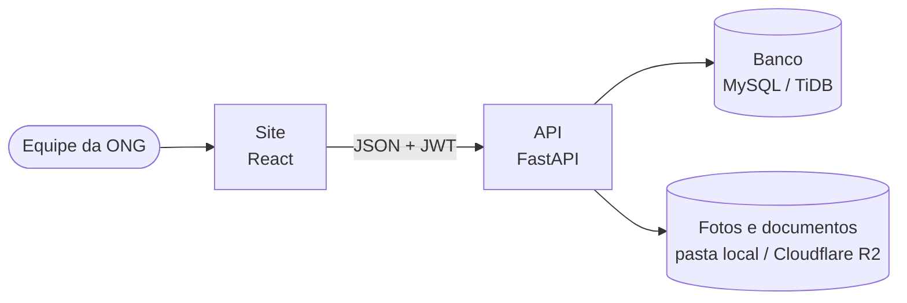

<div align="center">


# ARDAP

**Sistema de gestão da Associação Recanto dos Animais em Perigo**

Digitaliza os formulários em papel da ONG, reúne o histórico de cada animal<br>
e gera a prestação de contas para a prefeitura.


[Sobre](#sobre) •
[Funcionalidades](#funcionalidades) •
[Arquitetura](#arquitetura) •
[Como rodar](#como-rodar) •
[Produção](#produção) •
[Equipe](#equipe)

</div>

---

## Sobre

A **ARDAP** resgata, trata e encaminha animais para adoção em Paulo Afonso/BA. Os
registros ficavam em formulários de papel, sem histórico por animal, sem controle de
acesso e com o relatório mensal feito à mão.

Este sistema substitui o papel por uma aplicação web usada pela equipe interna da ONG.
É um projeto de extensão do curso de **Sistemas de Informação da UNIRIOS**.

## Funcionalidades

| Módulo | O que faz |
|---|---|
| **Início** | Painel com indicadores, evolução mensal e gráficos de todos os módulos |
| **Animais** | Cadastro com foto, busca, filtros e ficha completa |
| **SUPATAS** | Registro de resgates e encaminhamentos |
| **Adoções** | Questionário e termo de adoção |
| **Castrações** | Termos de castração e lista de animais já castrados |
| **Cirurgias** | Termos de procedimentos cirúrgicos |
| **Eutanásias** | Termo de consentimento |
| **Hipossuficiência** | Declaração com documentos anexados (PDF ou imagem) |
| **Relatórios** | Prestação de contas por período, em PDF e Excel |
| **Usuários** | Cadastro e permissões (só administradores) |

**Regras que o sistema garante**

- Um animal que passou por eutanásia não pode ser vinculado a novos formulários
  e sai da listagem de animais, ficando na de eutanásias.
- Um animal já adotado não pode ser vinculado a outra adoção.
- Salvar um termo de castração marca o animal como castrado.
- Cada registro mostra quem cadastrou e quem alterou por último.
- Excluir um animal exclui também os formulários dele; excluir um formulário mantém o
  animal cadastrado.
- Usuários com registros em seu nome não podem ser excluídos, o que preserva a autoria.
- Os relatórios trazem apenas totais, sem dados pessoais. Bairros e cidades com menos de
  3 registros são somados.

## Arquitetura



| Camada | Tecnologias | Desenvolvimento | Produção |
|---|---|---|---|
| Site | React, TypeScript, Vite, Tailwind CSS | `localhost:5173` | Cloudflare Workers |
| API | Python, FastAPI, SQLAlchemy, Pydantic | `localhost:8000` | Render |
| Banco | SQL relacional | MySQL 8 | TiDB Cloud |
| Arquivos | S3 (boto3) | `Backend/uploads` | Cloudflare R2 |
| Backup | Script Python | – | GitHub Actions, diário |

### Estrutura do repositório

```
ARDAP/
├── Backend/
│   ├── app/
│   │   ├── core/       configuração, banco, segurança e regras
│   │   ├── models/     tabelas (SQLAlchemy)
│   │   ├── schemas/    formatos de entrada e saída (Pydantic)
│   │   ├── routers/    rotas da API
│   │   ├── scripts/    administrador, backup e restauração
│   │   └── seeders/    dados fictícios
│   └── db/             scripts SQL
├── Frontend/
│   └── src/
│       ├── components/ componentes reutilizáveis
│       ├── context/    sessão do usuário
│       ├── hooks/      lógica compartilhada
│       ├── pages/      telas
│       └── services/   acesso à API e formatação
├── ai-model/           modelo de IA, ainda não integrado ao sistema
├── datasets/           dados usados no modelo
└── Docs/               documentação
```

## Como rodar

### 1. Pré-requisitos

| Programa | Versão | Para conferir |
|---|---|---|
| [Git](https://git-scm.com) | qualquer recente | `git --version` |
| [Python](https://www.python.org/downloads/) | 3.13 | `python --version` |
| [Node.js](https://nodejs.org) | 22.12 ou mais nova | `node --version` |
| [MySQL](https://dev.mysql.com/downloads/) | 8 | `mysql --version` |

<details>
<summary><b>Windows</b></summary>

<br>

Instale os quatro pelos links acima. No instalador do Python, marque **Add to PATH**. No
do MySQL, guarde a senha do `root` e inclua o **MySQL Workbench**.

</details>

<details>
<summary><b>Linux (Ubuntu/Debian)</b></summary>

<br>

```bash
sudo apt update
sudo apt install -y git curl mysql-server
```

No Debian, instale o MySQL 8 pelo [repositório oficial](https://dev.mysql.com/downloads/repo/apt/):
o pacote `mysql-server` pode não existir.

Python 3.13, se a sua versão não o tiver (com o [uv](https://docs.astral.sh/uv/)):

```bash
curl -LsSf https://astral.sh/uv/install.sh | sh
source ~/.bashrc
uv python install 3.13
```

Node.js, com o [nvm](https://github.com/nvm-sh/nvm#installing-and-updating):

```bash
nvm install 22
```

No Ubuntu, o `root` do MySQL costuma entrar só com `sudo`. Crie um usuário para o projeto,
trocando a senha:

```bash
sudo mysql -e "CREATE USER 'ardap'@'localhost' IDENTIFIED BY 'troque-esta-senha'; GRANT ALL ON ardap.* TO 'ardap'@'localhost';"
```

</details>

<details>
<summary><b>macOS</b></summary>

<br>

Com o [Homebrew](https://brew.sh):

```bash
brew install git python@3.13 node@22 mysql@8.4
brew services start mysql@8.4
echo 'export PATH="$(brew --prefix)/opt/node@22/bin:$(brew --prefix)/opt/mysql@8.4/bin:$PATH"' >> ~/.zshrc
source ~/.zshrc
```

</details>

### 2. Baixar o projeto

```bash
git clone https://github.com/PROJETO-WEB-EXTENSAO-6-PERIODO/ARDAP.git
cd ARDAP
```

### 3. Criar o banco

Execute os arquivos de `Backend/db` **nesta ordem**:

1. `schema_min.sql`
2. `schema_adocao.sql`
3. `schema_castracao.sql`
4. `schema_cirurgia.sql`
5. `schema_eutanasia.sql`
6. `schema_hipossuficiencia.sql`

**Windows:** no MySQL Workbench, abra cada arquivo e clique no raio para executá-lo inteiro.

**Linux e macOS:** com o usuário criado no passo 1 (no macOS, use `root` e, se ele não
tiver senha, tire o `-p`):

```bash
cd Backend/db
cat schema_min.sql schema_adocao.sql schema_castracao.sql schema_cirurgia.sql \
    schema_eutanasia.sql schema_hipossuficiencia.sql | mysql -u ardap -p
cd ../..
```

> [!NOTE]
> Os `alter_*.sql` são só para quem já tinha um banco de uma versão anterior. Em um banco
> novo, não os execute.

### 4. Configurar a API

**Windows (PowerShell)**

```powershell
cd Backend
py -3.13 -m venv .venv
.venv\Scripts\python -m pip install -r requirements.txt
copy .env.example .env
.venv\Scripts\python -c "import secrets; print(secrets.token_hex(32))"
notepad .env
```

**Linux e macOS**

```bash
cd Backend
python3.13 -m venv .venv          # com uv: uv venv --seed --python 3.13 .venv
.venv/bin/python -m pip install -r requirements.txt
cp .env.example .env
.venv/bin/python -c "import secrets; print(secrets.token_hex(32))"
nano .env
```

No `.env`, preencha:

| Variável | Valor |
|---|---|
| `DB_USER` | usuário do MySQL (`root` ou `ardap`) |
| `DB_PASSWORD` | senha desse usuário |
| `SECRET_KEY` | o código que o comando acima mostrou |

Deixe o resto como está: sem o R2, os arquivos ficam em `Backend/uploads`.

> [!WARNING]
> Nunca envie o `.env` para o Git.

### 5. Criar o administrador e os dados de exemplo

**Windows**

```powershell
.venv\Scripts\python -m app.scripts.criar_admin
.venv\Scripts\python -m app.seeders.todos
```

**Linux e macOS**

```bash
.venv/bin/python -m app.scripts.criar_admin
.venv/bin/python -m app.seeders.todos
```

A senha precisa de 12 caracteres ou mais e não aparece ao digitar. O segundo comando é
opcional: cria dados **fictícios** e só roda em banco vazio. As fotos de exemplo não estão
no repositório; sem elas, os animais são criados sem foto.

### 6. Iniciar

Use dois terminais, ambos a partir da pasta `ARDAP`.

**Windows**

```powershell
# terminal 1: API
cd Backend
.venv\Scripts\python -m uvicorn app.main:app --reload
```

```powershell
# terminal 2: site
cd Frontend
npm.cmd install
npm.cmd run dev
```

**Linux e macOS**

```bash
# terminal 1: API
cd Backend
.venv/bin/python -m uvicorn app.main:app --reload
```

```bash
# terminal 2: site
cd Frontend
npm install
npm run dev
```

| Endereço | O que é |
|---|---|
| http://localhost:5173 | Sistema |
| http://localhost:8000/docs | Documentação da API |

> [!IMPORTANT]
> Abra o sistema por `localhost`. Com `127.0.0.1`, o login é bloqueado pelo CORS.

Nas próximas vezes, basta este passo, sem o `npm install`.

### Problemas comuns

| Mensagem | Solução |
|---|---|
| `Access denied for user` | Confira `DB_USER` e `DB_PASSWORD` no `.env` |
| `SECRET_KEY ... at least 32 characters` | Preencha a `SECRET_KEY` |
| `Can't connect to MySQL server` | Inicie o serviço do MySQL |
| `Unknown database 'ardap'` ou `Table ... doesn't exist` | Refaça o passo 3 |
| `Unknown column` | O banco é antigo: execute os `alter_*.sql` que faltam |
| `No module named ...` | Instale de novo o `requirements.txt` |
| "Não foi possível conectar ao servidor" | Veja se a API está rodando |

### Comandos úteis

| Comando | Pasta | O que faz |
|---|---|---|
| `npm run build` | `Frontend` | Confere os tipos e gera a versão de produção |
| `npm run lint` | `Frontend` | Procura problemas no código |
| `python -m app.scripts.backup` | `Backend` | Faz o backup (precisa do R2) |
| `python -m app.scripts.restaurar` | `Backend` | Restaura uma cópia em um banco novo |

Os comandos `python` usam o Python da `.venv`.

## Produção

O merge na `main` publica o site (Cloudflare) e a API (Render). Mudanças no banco são
aplicadas à mão, com os scripts de `Backend/db`.

| Serviço | Papel |
|---|---|
| Cloudflare Workers | Site |
| Render | API |
| TiDB Cloud | Banco de dados |
| Cloudflare R2 | Fotos e documentos, em bucket privado |
| GitHub Actions | Backup diário do banco e dos arquivos |

As variáveis e os cuidados estão em [`Backend/README.md`](Backend/README.md).

**Segurança**

- Senhas com bcrypt e sessão por token JWT, que dura 8 horas.
- Limite de 10 tentativas de login por e-mail a cada 15 minutos.
- Em produção, a API não inicia sem TLS no banco, CORS em HTTPS, R2 e `SECRET_KEY`.
- Fotos e anexos só são entregues a quem fez login.
- O formato dos arquivos é conferido pelo conteúdo, não pelo nome.

## Equipe

Bacharelado em Sistemas de Informação, 6º período, UNIRIOS.

- Guilherme Matheus Silva Oliveira
- Pedro Victor Correia de Souza Santos
- Erivelton Brasil Batista
- Victor Hugo Sousa Oliveira
- Rubriel Luan Marques de Lima

---

<div align="center">

Feito para a **ARDAP**, Paulo Afonso/BA 🐾

</div>
